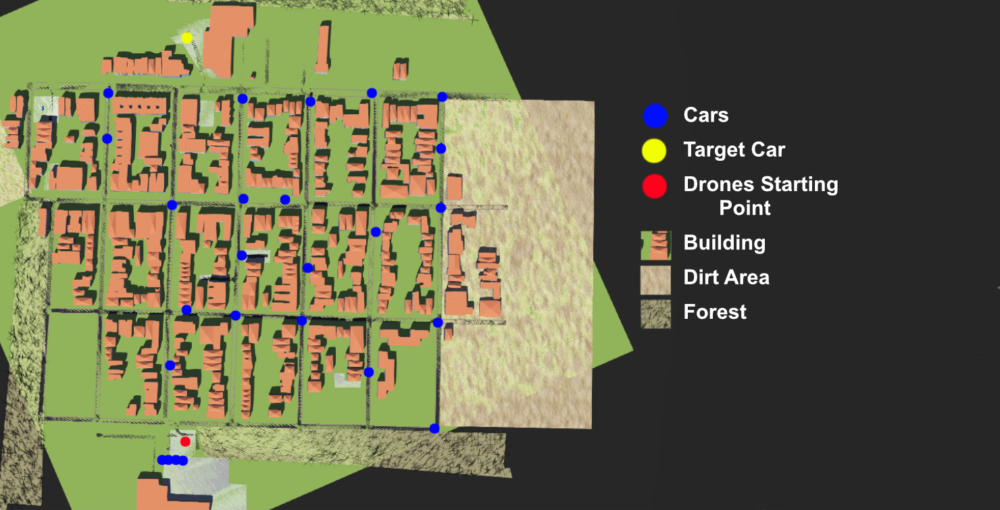
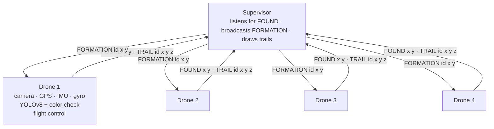
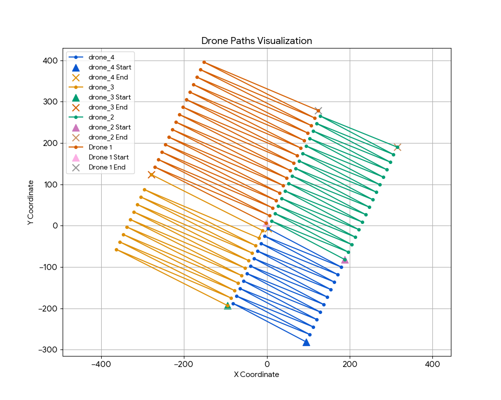

# Autonomous Multi-UAV Urban Search: Webots + YOLOv8

Four simulated DJI Mavic 2 Pro drones split a city into sectors, sweep it in a zig-zag pattern, and look for one specific car among parked look-alikes. The first drone to confirm the target alerts a supervisor, and the whole swarm converges on it in formation.


*Full-length recording: [`Timeline 1.webm`](Timeline%201.webm)*

---
> [!TIP]
> Starter tutorial I made for WeBots is placed in repo as "WEBOTS TUTORIAL HANDBOOK", feel free to use it.
---

## Highlights

- **4-drone swarm** with per-drone flight control, sector assignment and a central supervisor.
- **Custom-trained YOLOv8 detector** (119 annotated Webots frames) plus a **color-verification step** that separates the target from other vehicles of the same class.
- **Boustrophedon (zig-zag) coverage** of four sectors, rotated to follow the city's street grid.
- **Event-driven swarm behavior:** sector search switches to formation flight as soon as the target is confirmed.
- **Flight logging and live trails:** waypoints and GPS tracks are written to CSV, and each drone's path is drawn in the 3D view in its own color.
- **Realistic urban map** imported from OpenStreetMap (a New York district) with 3D buildings, vegetation and distractor vehicles.

## Mission

| | |
| --- | --- |
| **Problem** | A single drone searching a dense city is slow, and testing swarm logic on real hardware is expensive and risky. |
| **Approach** | Validate multi-agent coordination and the computer-vision pipeline in a physics simulator before any physical deployment. |
| **Goal** | Cover the whole search area, find the target among distractors, and converge the swarm on it. |



## System architecture



Drones and supervisor talk over Webots emitter/receiver devices (simulated radio).

### 1. Flight control

Each drone runs `city_search_drone.py` with its ID (1 to 4) as the controller argument. The control loop runs every simulation step (8 ms):

- **Altitude:** a cubic proportional term on the clamped altitude error, added to a hover thrust constant.
- **Attitude:** roll and pitch are stabilized with proportional terms on the angle plus gyro-rate damping.
- **Motor mixing:** altitude, roll, pitch and yaw commands are mixed into the four rotor velocities.
- **Navigation** (every 0.2 s): yaw is steered toward the next waypoint, and forward pitch is scaled by distance (faster when far, gentler within 10 m). A waypoint counts as reached within 1 m.

| Parameter | Value |
| --- | --- |
| Hover thrust | 68.5 |
| Vertical offset | 0.6 |
| Altitude gain | 10.0 |
| Roll gain | 15.0 |
| Pitch gain | 1.0 |
| Search altitude | 25 m |

The structure follows the Webots Mavic 2 Pro example controller, with retuned gains and added takeoff gating, waypoint navigation and mission states.

### 2. Coverage path planning



- The search area is split into **four quadrants**, one per drone.
- Each quadrant gets a **boustrophedon sweep**: parallel strips **10 m apart** with a 5 m margin.
- All waypoints are **rotated by −24.9°** so the sweep lines follow the street grid instead of cutting diagonally across blocks.
- The approach follows the polygon decomposition method for cooperative UAV search described by Acevedo et al. (2013).

### 3. Target detection

Every 15 control steps (~120 ms), each searching drone:

1. Grabs its camera frame (BGRA from Webots, sliced to BGR with NumPy).
2. Runs a **custom YOLOv8 model** (`yolov8_trained.pt`), keeping only the vehicle class with **confidence ≥ 0.65**.
3. Samples the pixel at the center of each box and compares it to the target color **RGB (0, 85, 255)** / `#0055FF`. The detection is confirmed if the summed channel difference is below 255.

The color check matters because YOLOv8 can tell that something is a car but not *which* car. It is what rejects the parked Tesla and Lincoln distractors while accepting the blue BMW X5.

**Training data:** 119 images captured inside the Webots world and labelled in Roboflow. The split is 70% train, 20% validation and 10% test, augmented with flips, rotation, noise and brightness changes. The dataset is in [`yolo training data/`](yolo%20training%20data).

<!-- Add detection metrics from Roboflow/Ultralytics here: mAP@0.5, precision, recall on the test split -->

### 4. Swarm coordination

1. **SEARCH:** every drone flies its own sweep independently.
2. **FOUND:** the drone that confirms the target sends `FOUND x y` with its position.
3. **FORMATION:** the supervisor estimates the target position and broadcasts `FORMATION id x y` to all four drones.
4. **CONVERGE:** each drone flies to its slot in a 2 m cross around the target and descends from 25 m to 3 m.

## Results

In simulation, the full mission ran end to end:

| Stage | Outcome |
| --- | --- |
| Deployment | All four drones took off autonomously to 25 m. |
| Search | Each drone flew its assigned sector sweep until the target was found. |
| Detection | The target was identified, and distractor cars were rejected by the color check. |
| Convergence | The swarm executed the formation command over the target. |

## Getting started

**Requirements:** [Webots](https://cyberbotics.com/) R2023b or later, Python 3.8+.

```bash
git clone https://github.com/newtonhaven/Webots-city-search-DJI-YOLO.git
cd Webots-city-search-DJI-YOLO
pip install ultralytics numpy
```

1. Open `worlds/my_world.wbt` in Webots.
2. If Webots does not find your Python install, set the Python command in **Tools → Preferences**.
3. Run the simulation. The drones take off, sweep their sectors and print detections to the Webots console.

Each drone writes `drone_<ID>_waypoints.csv` and `drone_<ID>_gps_log.csv` next to its controller. You can use them to plot the flown paths.

## Project structure

```text
controllers/
├── city_search_drone/
│   ├── city_search_drone.py   # Flight control, sweep planning, YOLO + color check, radio, logging
│   └── yolov8_trained.pt      # Custom YOLOv8 weights
└── supervisor/
    └── supervisor.py          # FOUND → FORMATION relay, trail drawing
worlds/my_world.wbt            # OSM-based city world
protos/                        # Robot and object definitions
yolo training data/            # Annotated training images
```

## Why Webots

| Option | Verdict |
| --- | --- |
| **Webots** | ✅ Built-in multirotor physics (thrust, drag) and GPS, IMU, gyro and camera sensors. Ran four drones on the available hardware. |
| Unity | ❌ Game-oriented physics. Accurate rotor thrust and drag would have needed substantial custom code. |
| NVIDIA Isaac Sim | ❌ Frame rate dropped sharply with several drones rendering and simulating at once on the available hardware. |

## Limitations

- **Single point of failure.** All coordination goes through the supervisor. If it fails, the swarm loses coherence.
- **Ideal radio.** Messages arrive instantly and are never lost. Latency, range and interference are not modelled.
- **Approximate target position.** The finding drone reports its own position, and the supervisor applies a fixed offset tuned for this scene. The target is not geolocated from the image.
- **Fragile color check.** A single center pixel can land on a windshield, tire or shadow and reject a correct detection.
- **Static world.** Targets are parked, so there is no tracking. Drones fly fixed-altitude GPS waypoints and have no obstacle avoidance.
- **Compute cost.** Four YOLOv8 instances plus physics on one machine cause noticeable frame-rate drops.
- **No quantitative evaluation yet.** Detection metrics and time-to-find over repeated runs are still to be measured.

## Future work

- **Geolocate detections** by projecting the box center onto the ground plane using the camera intrinsics, drone altitude and attitude.
- **More robust verification:** compare the color distribution (e.g., an HSV histogram) inside the whole box instead of one pixel.
- **Decentralized coordination:** a peer-to-peer mesh where drones share findings directly, removing the supervisor as a single point of failure.
- **Edge inference:** run detection on the drones or a ground station to scale beyond four agents.
- **Depth/LiDAR** for SLAM and dynamic obstacle avoidance, plus Kalman-filter tracking for moving targets.
- **Benchmarks:** report precision/recall on the test split and mean time-to-find over many randomized runs.

## References

- Acevedo, J. J., Arrue, B. C., Diaz-del-Rio, F., & Ollero, A. (2013). *Multiple UAV cooperative searching operation using polygon area decomposition and efficient coverage algorithms.* Distributed Autonomous Robotic Systems.
- Jocher, G., Chaurasia, A., & Qiu, J. (2023). *Ultralytics YOLOv8.* https://github.com/ultralytics/ultralytics
- Cyberbotics Ltd. *Webots robot simulator.* https://cyberbotics.com
- OpenStreetMap contributors. https://www.openstreetmap.org

## License

Released under the [MIT License](LICENSE).
